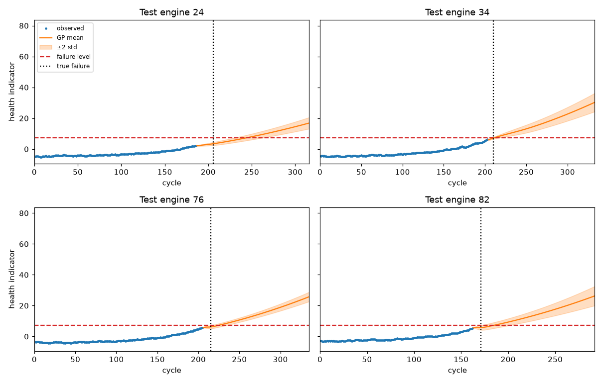
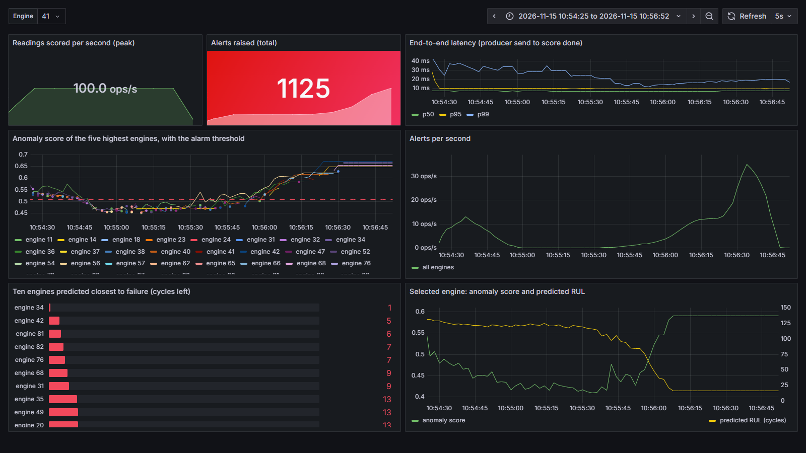

# sensor-edge-ai

Remaining useful life (RUL) prediction for turbofan engines on NASA C-MAPSS, with anomaly detection, Gaussian process uncertainty, INT8 edge inference and a live streaming demo through Redpanda, Prometheus and Grafana.

The dataset is C-MAPSS, the default in the project spec. FD001 is the headline subset. FD002 to FD004 are also run.

## Status

| Milestone | Scope | State |
|---|---|---|
| M1 | Data pipeline and classical baselines | Done |
| M2 | LSTM and 1D-CNN RUL models | Done for FD001 and FD002 |
| M3 | Anomaly detection and Gaussian process uncertainty | Done for FD001 (GP) and FD001 and FD002 (detectors) |
| M4 | ONNX export, INT8 quantisation, edge benchmark | Done on the ARM64 laptop (no Raspberry Pi) |
| M5 | Redpanda streaming and Grafana | Done |

## M1 pipeline

1. Split the training engines into train and validation sets by engine unit, so no engine appears on both sides. The official test file holds different engines.
2. Cluster the three operating settings with k-means (one cluster for FD001 and FD003, six for FD002 and FD004) and standardise every sensor within its cluster. Clusters and statistics are fitted on the training engines only.
3. Drop sensors that are constant after normalisation. The list is derived from the data and differs between subsets.
4. Label each training cycle with the RUL, capped at 125 cycles. Early in an engine's life degradation is not visible, so the target stays flat until the engine nears failure.
5. Build a window of 30 cycles ending at each cycle. Short histories are padded by repeating the first reading, which also lets the shortest test engines be scored.
6. Summarise each window with the mean, standard deviation, slope and last value of every sensor, then fit linear regression and gradient boosting.

Test scoring uses the last window of each official test engine against the official RUL file. The metrics are RMSE and the PHM08 NASA score, which penalises late predictions more than early ones.

## M2 models

An LSTM (two layers, 64 hidden units) and a 1D-CNN (three convolutions over the time axis) read the same normalised windows as the baselines. Both are trained with Adam and MSE on the RUL scaled by the cap, with early stopping on validation RMSE, and each is run with three seeds.

## M3 anomaly detection and uncertainty

Two detectors learn what healthy windows look like and flag windows that differ: an isolation forest on the window features, and an autoencoder that scores a window by how badly it rebuilds it. They are checked on faults injected into healthy test windows (spike, drift, stuck sensor) and on windows within 30 cycles of failure. At a threshold that allows about 5 percent false alarms they miss most injected faults. On windows close to failure the isolation forest does well (AUC 0.997 on FD001) and the autoencoder does not (AUC 0.810, recall 0.23). The full precision and recall table is in [RESULTS.md](RESULTS.md).

A health indicator (the first principal component of the normalised sensors) is extrapolated with a Gaussian process to estimate when it reaches the failure level, and the band gives an interval on the remaining life.



The orange line is the Gaussian process mean and the band is plus or minus 2 standard deviations. The dashed line is the failure level and the dotted line is the true failure cycle. The plot shows the lowest numbered test engine in each true RUL range (28, 50, 112 and 145 cycles left), not hand-picked examples. The engine closest to failure has a band that contains the true failure. The engine with 145 cycles left shows no degradation yet, so the forecast has nothing to extrapolate. Over all 100 FD001 test engines the forecast is poor, and the interval contains the true RUL for only 10 percent of them (32 percent for engines within 30 cycles of failure). RESULTS.md has the breakdown.

## M4 edge inference

The LSTM and the 1D-CNN are exported to ONNX and quantised to INT8 two ways with ONNX Runtime (dynamic, and static with calibration windows from the training engines). Each variant is benchmarked on the laptop's ARM64 CPU with one thread and one window per prediction.

| Model | Variant | Size (KB) | p50 (ms) | Test RMSE |
|---|---|---|---|---|
| LSTM | PyTorch fp32 | 223.2 | 0.995 | 16.80 |
| LSTM | ONNX fp32 | 223.8 | 0.094 | 16.80 |
| LSTM | ONNX dynamic INT8 | 67.2 | 0.066 | 16.78 |
| 1D-CNN | PyTorch fp32 | 562.4 | 0.182 | 16.67 |
| 1D-CNN | ONNX fp32 | 560.8 | 0.034 | 16.67 |
| 1D-CNN | ONNX static INT8 | 149.7 | 0.018 | 16.75 |

ONNX Runtime is 5 to 11 times faster than PyTorch at batch size 1 (10.6 times for the LSTM, 5.4 times for the CNN) with the same predictions. INT8 cuts size by 70 percent for the LSTM (dynamic) and 73 percent for the CNN (static) and speeds up inference, for a test RMSE change of at most 0.09. Static INT8 does nothing for the LSTM, and dynamic INT8 gives the CNN almost no speed-up. Memory does not improve: every ONNX variant adds about 11.5 MB, because the cost is the runtime and not the weights. The full table with p95 latency, memory and the other variants is in [RESULTS.md](RESULTS.md). The benchmark ran in WSL2 on the laptop, not natively on Windows, and a Raspberry Pi was not benchmarked.

## M5 streaming

The FD001 test engines are replayed into a Redpanda topic at 100 readings per second. A consumer scores each reading as it arrives, with the INT8 1D-CNN for RUL and an isolation forest for an anomaly score, and exposes the scores to Prometheus. Grafana shows the scoring rate, alerts, end-to-end latency, anomaly scores and predicted RUL per engine. Alerts are also written to a second topic.



End-to-end latency from the producer sending a reading to the consumer finishing its score had a median of 5.3 to 5.6 ms over three runs of the full replay, with a p99 of 13, 17 and 708 ms. The consumer kept up in every run. The alerts follow engine wear (98 percent of readings within 30 cycles of failure raise one) and do not catch a spike planted in a single sensor, which matches the weak spike recall of this detector in M3. [RESULTS.md](RESULTS.md) has the latency table for all three runs and the alert breakdown.

To run it, start the stack, train the models, and run the demo. Grafana is at http://localhost:3300 and opens on the dashboard without a login. The host ports (3300, 9190, 19092) are chosen to avoid common local ports.

```
make stream-up       # Redpanda, Prometheus and Grafana, plus the two topics
make stream-models   # trains the CNN, the forest and the alarm threshold (needs torch)
make stream-demo     # replays the engines and scores them live
make stream-down
```

The consumer and producer need `pip install -e .[stream]`. The consumer exposes metrics on port 8000, which Prometheus reaches as `host.docker.internal`. The demo runs one consumer on one partition, and the replay is recorded data and not live sensors.

## Results

FD001 test RMSE is 16.61 for linear regression, 14.53 for gradient boosting, 16.10 for the LSTM and 16.14 for the 1D-CNN. The networks do not beat gradient boosting on FD001. On FD002 the LSTM matches it on test RMSE and the 1D-CNN is behind it. The full tables, including the effect of per-condition normalisation on FD002, are in [RESULTS.md](RESULTS.md).

## Run it

The core package needs only numpy, pandas and scikit-learn.

```
pip install -e .[dev]
make data        # download C-MAPSS and verify the checksums
make test
make lint
make baselines   # writes artifacts/baselines.md
make deep        # needs torch: pip install -e .[deep]; writes artifacts/deep_models.md
```

`make edge` needs torch and the ONNX tools (`pip install -e .[deep,edge]`) and writes `artifacts/edge.md`. `make anomaly` and `make uncertainty` need torch for the autoencoder and matplotlib for the plot (`pip install -e .[deep,plots]`). `make deep` trains on CPU and takes several minutes per subset. The torch tests skip themselves when torch is not installed.

`make data` downloads from the PHM data mirror, because the NASA portal link rejects scripts. It checks the SHA-256 of both archives.

## Limitations

Results use one engine split. The baselines are a single run and the networks use three seeds, so small differences between models are not significant. The validation RMSE is measured over every cycle of the held-out engines, while the test RMSE uses only the last cycle of each test engine, so the two are not directly comparable. The training target is capped at 125 cycles but the official test RUL is not, which sets a floor on test RMSE (3.74 for FD001, 18.32 for FD002). RESULTS.md has the full floor table.
