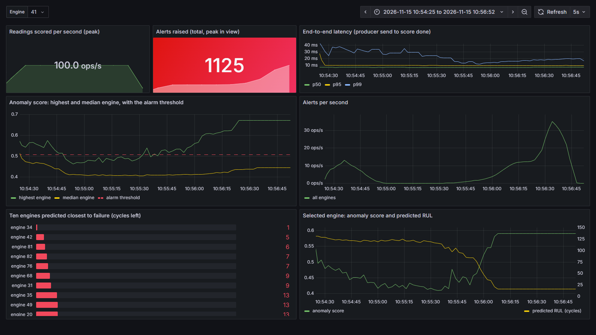

# Results

The M1 numbers come from `scripts/run_baselines.py` (`make baselines`) and the M2 numbers from `scripts/run_deep.py`. Both use the default `ExperimentConfig` (window of 30 cycles, RUL target capped at 125, engine split seed 0).

## M1: baselines

Lower is better for every column. Validation RMSE is measured on a held-out 20 percent of the training engines, over every cycle, against the capped target. Test RMSE and the NASA score use the last cycle of each official test engine against the official RUL file, which is not capped.

| Subset | Model | Val RMSE | Test RMSE | Test NASA score |
|---|---|---|---|---|
| FD001 | Linear regression | 15.38 | 16.61 | 466 |
| FD001 | Gradient boosting | 11.82 | 14.53 | 294 |
| FD002 | Linear regression | 16.74 | 28.64 | 11827 |
| FD002 | Gradient boosting | 14.57 | 26.93 | 8287 |
| FD003 | Linear regression | 16.61 | 18.38 | 616 |
| FD003 | Gradient boosting | 13.04 | 15.70 | 450 |
| FD004 | Linear regression | 19.03 | 30.36 | 7729 |
| FD004 | Gradient boosting | 15.98 | 26.74 | 4824 |

FD001 is the headline subset because published results use it. FD002 and FD004 mix six operating conditions.

### The RUL cap sets a floor on test RMSE

Models are trained on a target capped at 125 cycles, so they cannot predict a larger RUL, but the official test RUL is not capped. Many test engines have a true RUL above 125 (57 of 259 in FD002 and 67 of 248 in FD004). A model that predicted `min(true RUL, 125)` perfectly would still score:

| Subset | Lowest possible test RMSE |
|---|---|
| FD001 | 3.74 |
| FD002 | 18.32 |
| FD003 | 4.71 |
| FD004 | 19.53 |

Much of the gap between FD001 and FD002 or FD004 in test RMSE comes from this floor, not only from the operating conditions. Validation RMSE, which uses the capped target, rises less between subsets (11.82 to 14.57 for gradient boosting).

### Effect of per-condition normalisation on FD002

The same pipeline with one global normalisation instead of one per operating condition:

| Subset | Model | Val RMSE | Test RMSE | Test NASA score |
|---|---|---|---|---|
| FD002 | Linear regression | 16.98 | 29.24 | 13687 |
| FD002 | Gradient boosting | 18.82 | 29.70 | 12087 |

Normalising per condition lowers the gradient boosting test RMSE from 29.70 to 26.93 and the NASA score from 12087 to 8287. Linear regression improves less, from 29.24 to 28.64.

## M2: deep models against the baselines

Produced on CPU with `scripts/run_deep.py --subsets FD001 FD002` (what `make deep` runs) and the same split, window and RUL cap as M1. The LSTM and 1D-CNN rows are the mean ± standard deviation over seeds 0, 1 and 2. The deviation is the population standard deviation (divided by 3, not 2), which is about 1.2 times smaller than the sample standard deviation. The seeds change weight initialisation, batch order and dropout masks, and the engine split stays fixed.

The Val RMSE of the networks is the best of up to 40 epoch scores on the validation engines, because early stopping picks the epoch with it. It is therefore optimistic compared with the baseline Val RMSE, which is a single score. Test RMSE and the NASA score are not affected, since the test engines play no part in choosing an epoch. Training stops when validation RMSE has not improved for 8 epochs (at most 40), and the weights from the best epoch are kept. Only FD001 and FD002 were run for M2. FD003 and FD004 are covered by the baselines table above.

| Subset | Model | Val RMSE | Test RMSE | Test NASA score | Train seconds |
|---|---|---|---|---|---|
| FD001 | Linear regression | 15.38 | 16.61 | 466 | |
| FD001 | Gradient boosting | 11.82 | 14.53 | 294 | |
| FD001 | LSTM | 12.31 ± 0.23 | 16.10 ± 0.58 | 558 ± 86 | 170 |
| FD001 | 1D-CNN | 13.58 ± 0.62 | 16.14 ± 0.85 | 456 ± 72 | 29 |
| FD002 | Linear regression | 16.74 | 28.64 | 11827 | |
| FD002 | Gradient boosting | 14.57 | 26.93 | 8287 | |
| FD002 | LSTM | 14.43 ± 0.32 | 26.68 ± 0.50 | 8854 ± 1015 | 242 |
| FD002 | 1D-CNN | 15.83 ± 0.29 | 27.40 ± 0.34 | 10218 ± 476 | 63 |

On FD001 neither network beats gradient boosting on hand-crafted features: test RMSE is 16.10 for the LSTM and 16.14 for the CNN against 14.53. They are about level with linear regression. On FD002 the LSTM is slightly ahead of gradient boosting on test RMSE (26.68 against 26.93, a gap smaller than its seed spread) and behind it on the NASA score (8854 against 8287). The 1D-CNN is behind gradient boosting on FD002 on both measures (27.40 and 10218). Validation RMSE is not used for this comparison because the two kinds of model are not scored the same way. The networks use plain defaults with no hyperparameter search, so these numbers are a starting point and not a ceiling. Gradient boosting and linear regression are single runs, so the comparison cannot say whether the 0.25 RMSE gap on FD002 is real.

## M3: anomaly detection

Produced by `scripts/run_anomaly.py` (`make anomaly`), one seed. Both detectors are fitted on healthy training windows only, meaning windows whose capped RUL still equals the cap. The alarm threshold is the 95th percentile of scores on healthy windows from the validation engines, so about 5 percent of healthy windows should raise an alarm. Everything is scored on the official test engines. C-MAPSS has no fault labels, so there are two checks.

Injected faults: a copy of every healthy test window gets one fault in one random sensor, and the faulted copies are the positives. The healthy originals are the negatives, so each row is balanced. Windows the fault did not change are left out. This only matters for stuck sensors: freezing a sensor that was already constant (for example a nearly constant sensor, or a window at cycle 1 that is all padding) changes nothing, which is why the stuck rows have fewer windows than the spike and drift rows. The sizes are in standard deviations of the normalised sensor: a spike of 5 over the last 3 cycles, a drift that ramps up to 4 across the window, and a sensor stuck at its first reading.

End of life: windows within 30 cycles of failure are the positives and healthy windows are the negatives, so there are many more negatives than positives.

| Subset | Detector | Check | Precision | Recall | F1 | AUC | False alarm rate | Healthy | Anomalous |
|---|---|---|---|---|---|---|---|---|---|
| FD001 | Isolation forest | spike | 0.68 | 0.08 | 0.15 | 0.721 | 0.040 | 8041 | 8041 |
| FD001 | Isolation forest | drift | 0.72 | 0.10 | 0.18 | 0.758 | 0.040 | 8041 | 8041 |
| FD001 | Isolation forest | stuck | 0.56 | 0.04 | 0.07 | 0.603 | 0.028 | 7646 | 7646 |
| FD001 | Isolation forest | end of life | 0.50 | 0.99 | 0.67 | 0.997 | 0.040 | 8041 | 332 |
| FD001 | Autoencoder | spike | 0.84 | 0.15 | 0.26 | 0.829 | 0.029 | 8041 | 8041 |
| FD001 | Autoencoder | drift | 0.93 | 0.37 | 0.53 | 0.922 | 0.029 | 8041 | 8041 |
| FD001 | Autoencoder | stuck | 0.49 | 0.03 | 0.06 | 0.465 | 0.031 | 7646 | 7646 |
| FD001 | Autoencoder | end of life | 0.25 | 0.23 | 0.24 | 0.810 | 0.029 | 8041 | 332 |
| FD002 | Isolation forest | spike | 0.70 | 0.11 | 0.20 | 0.718 | 0.050 | 20702 | 20702 |
| FD002 | Isolation forest | drift | 0.72 | 0.13 | 0.22 | 0.748 | 0.050 | 20702 | 20702 |
| FD002 | Isolation forest | stuck | 0.55 | 0.05 | 0.09 | 0.581 | 0.038 | 20430 | 20430 |
| FD002 | Isolation forest | end of life | 0.49 | 0.93 | 0.64 | 0.985 | 0.050 | 20702 | 1087 |
| FD002 | Autoencoder | spike | 0.85 | 0.12 | 0.21 | 0.810 | 0.022 | 20702 | 20702 |
| FD002 | Autoencoder | drift | 0.94 | 0.36 | 0.52 | 0.886 | 0.022 | 20702 | 20702 |
| FD002 | Autoencoder | stuck | 0.42 | 0.02 | 0.03 | 0.452 | 0.022 | 20430 | 20430 |
| FD002 | Autoencoder | end of life | 0.49 | 0.40 | 0.44 | 0.915 | 0.022 | 20702 | 1087 |

Findings:

- Both detectors keep false alarms near the 5 percent target (2 to 5 percent on healthy test windows), but they miss most injected faults. Recall is 2 to 15 percent for spikes and stuck sensors, and the best recall on any injected fault is 37 percent (the autoencoder on drift).
- The autoencoder is the better detector of injected spikes and drifts (AUC 0.81 to 0.92 against 0.72 to 0.76). Its alarms are precise when they fire (precision 0.84 to 0.94) but rare.
- A stuck sensor is barely detected by either method. The isolation forest has recall of 0.04 to 0.05 and an AUC of 0.58 to 0.60, only a little above chance. The autoencoder's AUC is below 0.5 (0.45 to 0.47), so frozen windows score as slightly more normal than healthy ones, which is likely because a constant sensor is easy to reconstruct.
- For windows close to failure the isolation forest is far better than the autoencoder: AUC 0.997 against 0.810 on FD001, with recall of 0.99 at a precision of 0.50. The isolation forest sees the mean, standard deviation, slope and last value of each sensor, and these shift as an engine wears. The autoencoder has to reconstruct the whole window.
- Injected faults are synthetic and the sizes were chosen by hand, so the recall figures describe these faults and not real sensor failures. The injected check and the end of life check measure different things, and neither detector is best on both.

## M3: uncertainty with a Gaussian process

Produced by `scripts/run_uncertainty.py` (`make uncertainty`) on FD001. A health indicator is built from the first principal component of the normalised sensors, oriented to rise with wear, smoothed with a 5 cycle trailing mean. The component and the failure level (the mean indicator value at the last cycle of the training engines) come from training engines only. For each test engine a Gaussian process (squared dot product kernel for the trend, an RBF kernel and white noise) is fitted to its observed indicator values and extrapolated for up to 250 cycles. The predicted RUL is the first cycle at which the mean reaches the failure level, and the interval runs from the first cycle at which the upper edge of the band (mean plus 2 standard deviations) reaches it to the first cycle at which the lower edge (mean minus 2 standard deviations) reaches it. The band is a 2 standard deviation band at each cycle. Taking where its edges cross the failure level does not give a calibrated 95 percent interval on the remaining life, so coverage is reported as measured and not compared with a nominal level.

If a curve never reaches the level within the 250 cycle horizon, that RUL or bound is set to 250. Coverage and width are computed with that value. An engine whose upper bound is 250 counts as covered whenever its true RUL is at or above the lower bound, and the width includes the 250. So the width understates the real uncertainty wherever this happens. The "No crossing in horizon" column is the share of engines with an upper bound of 250, meaning the lower edge of the band never reaches the failure level.

| Engines | RMSE | NASA score | Interval coverage | Mean interval width | No crossing in horizon |
|---|---|---|---|---|---|
| 100 | 107.73 | 1004006872 | 0.10 | 57.6 | 0.63 |

This is much worse than the M1 and M2 models (FD001 test RMSE 14.5 to 16.6). The breakdown by true RUL of the test engine shows why. It uses the official labels, so it is an analysis and not something a deployed system could know in advance.

| True RUL | Engines | RMSE | Interval coverage | Mean interval width | No crossing in horizon |
|---|---|---|---|---|---|
| 0 to 30 | 25 | 25.93 | 0.32 | 33.7 | 0.00 |
| 31 to 60 | 14 | 99.71 | 0.00 | 105.4 | 0.36 |
| 61 to 125 | 50 | 130.99 | 0.04 | 62.6 | 0.94 |
| over 125 | 11 | 115.41 | 0.00 | 28.2 | 1.00 |

- The forecast only works once degradation is visible. For engines within 30 cycles of failure the RMSE is 25.9, and the upper bound of the interval stays inside the horizon for every engine. For engines that are earlier in life the RMSE is 100 to 131 and the upper bound often runs off the horizon (94 to 100 percent of engines with a true RUL above 60). The indicator is still close to flat for these engines, so a trend fitted to it does not point at the failure level.
- The intervals miss often even where the forecast works: the true RUL is inside the interval for 0.32 of the engines within 30 cycles of failure. The "over 125" row has a width of only 28.2, but all of those engines are censored, so it shows that the forecast gives up and not that it is precise. The band reflects the uncertainty in the fitted trend and the noise, but not the error in the choice of a quadratic trend or in the failure level, which is an average over training engines.
- The NASA score of about 1e9 is most likely driven by engines whose forecast is far above the true RUL, because late predictions are penalised exponentially. It is reported for completeness and is not a useful comparison with the M1 and M2 scores.

The plot in the README shows one test engine from each true RUL range: the lowest unit number in each range (engines 18, 17, 1 and 25, with true RUL 28, 50, 112 and 145). The rule is in `pick_plot_units` in `scripts/run_uncertainty.py`, and it does not look at forecast quality. An earlier version of the plot used four hand-picked engines that were all close to failure. It was replaced because that choice made the forecast look better than it is.

## M4: edge optimisation

Produced by `scripts/run_edge.py` (`make edge`) on FD001. Both networks from M2 are exported, because the LSTM and the 1D-CNN are tied on test RMSE once seed spread is taken into account. Each is trained once with seed 0 (so the RMSE here differs from the three-seed mean in M2), exported to ONNX, and quantised to INT8 in two ways with ONNX Runtime. Dynamic quantisation converts the weights now and quantises activations at run time, with no example data. Static quantisation also fixes the activation ranges ahead of time, using 256 evenly spaced training windows (never test windows).

Device: the laptop's own ARM64 CPU (Snapdragon X Plus, 8 cores), measured from WSL2 (aarch64 Ubuntu) with onnxruntime 1.32.0. WSL2 is a lightweight virtual machine on the same chip, so absolute times may differ a little from native Windows. Each model is limited to one thread and predicts one window at a time (batch size 1). Accuracy is scored the same way, one window per call, because dynamic quantisation sets its activation scale from each input tensor and its output can depend on the batch. Latency is the time for 1000 predictions after 100 warm-up runs. Each ONNX variant runs in its own fresh process, which has no PyTorch loaded, so its memory is measured on its own. PyTorch is timed in the training process and its latency is the median of 3 repeated timings. A Raspberry Pi was not benchmarked.

| Model | Variant | Size (KB) | p50 (ms) | p95 (ms) | Memory added (MB) | Test RMSE | RMSE change | NASA score | Max diff vs PyTorch fp32 (cycles) |
|---|---|---|---|---|---|---|---|---|---|
| LSTM | PyTorch fp32 | 223.2 | 0.995 | 1.291 | n/a | 16.80 | +0.00 | 672 | n/a |
| LSTM | ONNX fp32 | 223.8 | 0.094 | 0.108 | 11.4 | 16.80 | -0.00 | 672 | 0.00 |
| LSTM | ONNX dynamic INT8 | 67.2 | 0.066 | 0.078 | 11.7 | 16.78 | -0.02 | 662 | 2.50 |
| LSTM | ONNX static INT8 | 222.5 | 0.095 | 0.108 | 11.7 | 16.83 | +0.03 | 673 | 0.51 |
| 1D-CNN | PyTorch fp32 | 562.4 | 0.182 | 0.225 | n/a | 16.67 | +0.00 | 489 | n/a |
| 1D-CNN | ONNX fp32 | 560.8 | 0.034 | 0.046 | 11.4 | 16.67 | +0.00 | 489 | 0.00 |
| 1D-CNN | ONNX dynamic INT8 | 149.4 | 0.031 | 0.033 | 12.0 | 16.76 | +0.09 | 506 | 1.17 |
| 1D-CNN | ONNX static INT8 | 149.7 | 0.018 | 0.018 | 11.6 | 16.75 | +0.08 | 500 | 1.64 |

"RMSE change" is the test RMSE minus that of the PyTorch fp32 model. "Max diff" is the largest difference in any single test prediction from the PyTorch fp32 model, in cycles. "Memory added" is the growth in resident memory from creating the session and running the benchmark, in a process that had already imported ONNX Runtime and numpy, so it leaves out the cost of loading the library itself. PyTorch memory was not measured because it includes the whole PyTorch library.

Findings:

- Moving from PyTorch to ONNX Runtime is the biggest speed gain at batch size 1: median latency falls from 0.995 to 0.094 ms for the LSTM (10.6 times) and from 0.182 to 0.034 ms for the CNN (5.4 times). The ONNX fp32 predictions match PyTorch to within 0.005 cycles on the test windows. PyTorch timings are less repeatable than ONNX ones. A separate check that timed untrained models of the same sizes in fresh processes gave about 1.3 ms for the LSTM and 0.29 ms for the CNN, so the speed-up may be larger than the table shows.
- Quantisation costs little accuracy. Test RMSE changes by at most 0.09 cycles and the NASA score by at most 17, and the largest single prediction moves by 2.5 cycles (LSTM, dynamic). The direction is not consistent (dynamic INT8 lowers the LSTM's RMSE by 0.02 and raises the CNN's by 0.09). This is one trained model per architecture scored on 100 test engines, so changes this small are not distinguishable from noise.
- The 1D-CNN gains the most from static INT8: median latency halves (0.034 to 0.018 ms) and the file shrinks to 150 KB from 561 KB, for an RMSE increase of 0.08. Dynamic INT8 gives the same file size (149 KB) but almost no speed-up (0.031 ms), for an RMSE increase of 0.09.
- For the LSTM only dynamic quantisation helps. It cuts the file to 67 KB from 224 KB (30 percent of the original) and median latency from 0.094 to 0.066 ms. Static quantisation leaves both LSTM operators in float, which an inspection of the graph confirms, and only the two linear layers at the end carry quantise and dequantise nodes. Its size and speed are unchanged.
- Memory does not improve. Every ONNX variant adds about 11.5 MB, whatever the precision. The weights are well under 1 MB, so the cost is set by the runtime's session and working buffers and not by the weights. On a device with little memory, the runtime is the thing to shrink.
- The ONNX fp32 median latencies matched across two complete runs of the benchmark that included retraining (0.095 and 0.094 ms for the LSTM, 0.034 and 0.034 ms for the CNN). An earlier version of this benchmark left convolutions out of dynamic quantisation on the mistaken belief that the CPU kernel could not run them. They run fine, and the table above includes them.
- These timings are for 1 thread and batch size 1 on this chip, and will not carry over unchanged to a Raspberry Pi.

## M5: streaming

Produced by `scripts/stream_demo.sh` (`make stream-demo`) on the FD001 test engines, with the models from `scripts/prepare_stream_models.py` (`make stream-models`). The 13,096 readings of the 100 test engines are replayed into a Redpanda topic one cycle at a time across all engines, at 100 readings per second, which takes 131 seconds. A consumer scores every reading as it arrives with a 1D-CNN (static INT8, through ONNX Runtime) for RUL and an isolation forest (100 trees) for an anomaly score. A reading raises an alert when its anomaly score is above 0.508, the 95th percentile of scores on healthy windows of the validation engines. Alerts are also written to a second topic. The consumer exposes its metrics to Prometheus, and Grafana reads them. Redpanda, Prometheus and Grafana run in Docker. The producer and consumer run on the same ARM64 laptop in WSL2, and Redpanda has one node and one partition. Nothing from the test engines is used to fit the models or the threshold.

The screenshot is the third run, taken over a window that covers only that run (about 2.5 minutes). The panels show the scoring rate, the running count of alerts, end-to-end latency percentiles, the anomaly score of the highest and the median engine against the alarm threshold, alerts per second, the ten engines predicted closest to failure, and the anomaly score and predicted RUL of a selected engine (engine 41 here).

### End-to-end latency

End-to-end latency is the time from the producer's clock reading just before it sends a message to the consumer's clock reading after it has finished scoring that reading. Both processes run on one machine, so they share a clock. Scoring is the time the consumer spent on one reading after receiving it. The replay was run three times, and all three are shown, because the tail differed a lot between runs.

| Run | Readings scored | Throughput (per s) | End-to-end p50 (ms) | p95 (ms) | p99 (ms) | max (ms) | Scoring p50 (ms) | p95 (ms) | p99 (ms) |
|---|---|---|---|---|---|---|---|---|---|
| 1, quiet machine, spike planted in engine 7 | 13096 | 100.1 | 5.31 | 7.60 | 13.03 | 105.5 | 4.30 | 5.71 | 8.31 |
| 2, dashboard loaded for the first time during the run | 13096 | 100.1 | 5.55 | 24.24 | 707.64 | 778.8 | 4.46 | 7.16 | 15.17 |
| 3, dashboard open | 13096 | 100.0 | 5.54 | 8.03 | 17.03 | 68.9 | 4.47 | 6.06 | 8.71 |

- Every run scored all 13,096 readings at the producer's pace of 100 per second on average. Run 2 had a temporary queue: a p99 of 708 ms means at least 131 readings waited more than 0.7 seconds.
- The median end-to-end latency was 5.3 to 5.6 ms in all three runs. About 4.3 to 4.5 ms of that is scoring, so the Kafka send and receive path adds about 1 ms.
- The tail varied between runs. Run 2 had a p99 of 708 ms, against 13 and 17 ms in the other two runs. During run 2 I loaded the dashboard for the first time and polled Prometheus, and I did not isolate the cause. The Grafana latency panel recorded the same spike, so the dashboard is showing real delays.
- Scoring one reading costs about 4 ms in a single process, which was measured separately on 1,000 readings without Kafka at 3.95 ms. That puts the ceiling near 250 readings per second for one consumer, and the replay at 100 per second uses a little under half of it. Throughput at higher rates was not measured through Kafka.

### Alerts

The replay raised 1,125 alerts over 13,096 readings (8.6 percent). The count was the same in the first and third runs. The table splits the readings by how far the engine really was from failure, using the official RUL file, and by whether the window was padded. A window is padded for the first 29 cycles of an engine, when fewer than 30 readings exist and the first reading is repeated to fill it. The counts come from the alerts topic of the first run.

| True RUL at the reading | Window | Readings | Alerts | Alert rate |
|---|---|---|---|---|
| 30 or less | full | 332 | 326 | 0.982 |
| 31 to 125 | full | 4,732 | 475 | 0.100 |
| 31 to 125 | padded | 80 | 0 | 0.000 |
| over 125 | full | 5,132 | 1 | 0.0002 |
| over 125 | padded | 2,820 | 323 | 0.115 |

- The alerts that mean something follow wear. Almost every reading within 30 cycles of failure raises one (98 percent), and one reading in ten raises one in the 31 to 125 range, starting around cycle 70. On full windows of healthy readings the rate is 1 in 5,132, far below the 5 percent the threshold was set for.
- Padded windows are the main source of false alarms. 323 of the 324 alerts on healthy readings (and 29 percent of all alerts) are in the first 29 cycles of an engine, and 93 of the 100 engines alert on their very first reading. A window made of one repeated reading looks unusual to the forest. The 4 percent alert rate over all healthy readings (padded and full windows together) is therefore mostly this start-up effect and not a sign that the threshold is calibrated. The threshold was set on validation windows that include padded ones (561 of 1,769), which probably explains why it is loose for full windows, but that was not tested. Holding back alerts until an engine has a full window of readings would remove these false alarms, and that was not done here.

The alerts do not follow injected spikes. In the first run a spike of 8 standard deviations of the fleet's sensor 11 values was planted in engine 7 for cycles 100 to 105. No alert was raised for engine 7 anywhere in cycles 100 to 134, which are all the windows that contain the spike (its only alerts are at cycles 1 and 2). A separate check scored engine 7 with spikes of 0, 8, 20, 50 and 100 standard deviations, using the same scale as the run. The highest anomaly score in cycles 100 to 134 was 0.441 with no spike, 0.453 with the 8 standard deviation spike and 0.457 for the larger ones, all under the threshold of 0.508. The spike does reach the scored window: the normalised value of that sensor changes by up to 5.9 units for the 8 standard deviation spike and 73.9 for the 100 standard deviation spike, and no other column changes. Shifting the last three rows of one sensor by 20, 100 and 1000 normalised units gives the same forest score (0.421), so the score saturates. This agrees with M3, where the isolation forest had low recall on injected spikes, and it means these alerts cannot be relied on for sudden single-sensor faults. A detector with better recall on those, such as the autoencoder from M3, would need to be added to the consumer.

## Notes

The test sets hold one score per engine (100, 259, 100 and 248 engines), so differences of one or two RMSE points between models are within the noise of a single seed. The comparison with a global normalisation uses the same seed and the same engine split.
